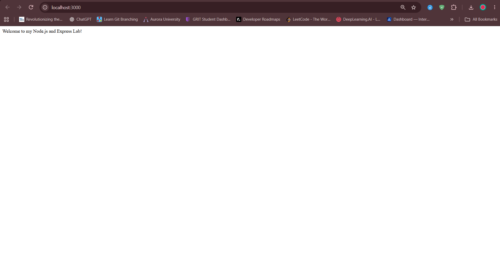
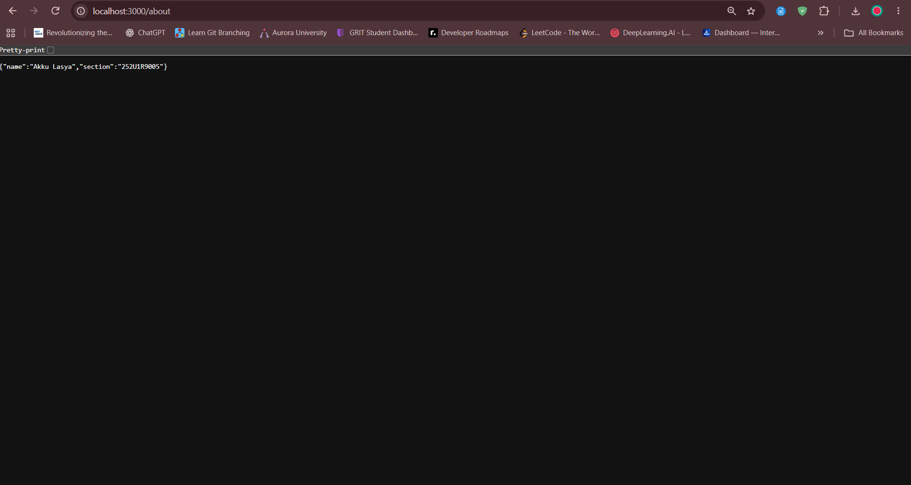
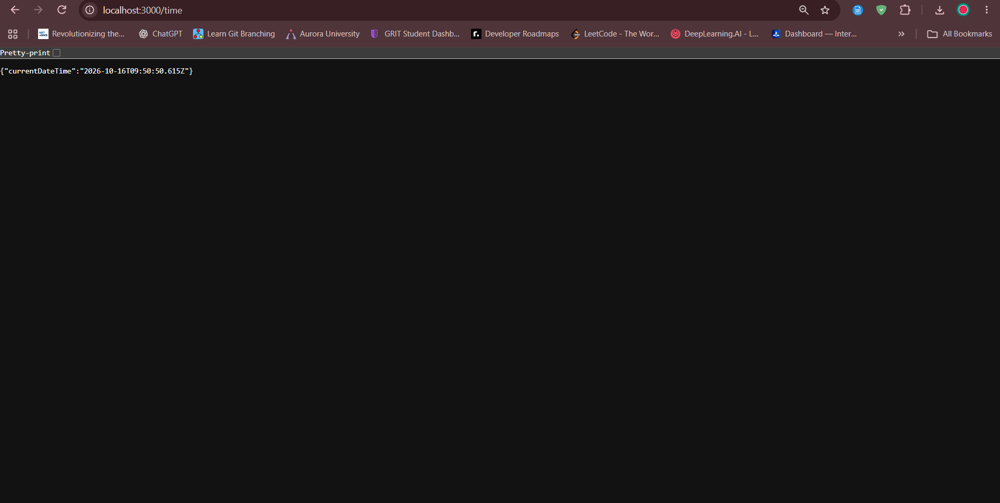

# Lab 1: Node.js and Express Server

## Student Details

- **Name:** Akku Lasya
- **Registration Number:** 252U1R9005
- **Section:** CSE GAI 2A
- **Course:** Backend Development Fundamentals
- **Lab Number:** 01

## Live Link

**Deployment URL:** [https://bdf-lab-01-wheat.vercel.app](https://bdf-lab-01-wheat.vercel.app)

## Objective

To set up a Node.js project, create a basic HTTP server using the built-in `http` module (`plain-server.js`), and build an Express server (`server.js`) with multiple routes and appropriate HTTP status codes.

## Technologies Used

- Node.js
- Express.js
- JavaScript (CommonJS)
- npm
- Visual Studio Code

## Project Structure

```text
lab-01/
├── screenshots/
│   ├── about.png
│   ├── home.png
│   ├── not-found.png
│   └── time.png
├── plain-server.js
├── server.js
├── package.json
├── package-lock.json
├── .gitignore
└── README.md
```

### File Explanations

- **`plain-server.js`**: Demonstrates low-level HTTP server creation using Node's native `http.createServer()` method, setting response headers (`writeHead`) and sending a response without third-party frameworks.
- **`server.js`**: Demonstrates server creation using Express.js framework, with route handlers (`app.get`) for root, about, time, and wildcard 404 middleware (`app.use`).
- **`screenshots/`**: Contains verification screenshots of all four routes when accessed via a browser or API client.
- **`package.json`**: Configures the project, defines `express` as a dependency, and provides npm scripts (`start`, `start:plain`).
- **`.gitignore`**: Prevents large build artifacts and dependencies (`node_modules/`, `.env`) from being committed to git.

## Installation and Setup

### Prerequisites

- Node.js (v18+ recommended) and npm installed
- Visual Studio Code or another code editor

### Steps to Run Express Server

1. Clone or open the repository.
2. Open the `lab-01` folder in your terminal:

   ```bash
   cd lab-01
   ```

3. Install project dependencies:

   ```bash
   npm install
   ```

4. Start the Express server:

   ```bash
   npm start
   ```

   *(or directly using `node server.js`)*

5. Open your browser and navigate to:

   `http://localhost:3000`

### Run the Basic HTTP Server

To test the server implemented using Node.js's built-in `http` module:

```bash
npm run start:plain
```

*(or directly using `node plain-server.js`)*

> **Note:** Stop any running server with `Ctrl + C` before launching another server on port 3000 to prevent port collision errors.

## Endpoints

| Method | Endpoint | Description | Expected Status | Content-Type |
|---|---|---|---|---|
| GET | `/` | Returns a welcome message | `200 OK` | `text/html` |
| GET | `/about` | Returns student details (`name`, `section`) as JSON | `200 OK` | `application/json` |
| GET | `/time` | Returns current date and timestamp as JSON | `200 OK` | `application/json` |
| GET | `/work` *(or any undefined path)* | Demonstrates 404 catch-all handler | `404 Not Found` | `text/html` |

The `/work` path is an example of an unknown route. Any request that does not match `/`, `/about`, or `/time` triggers the 404 error handler.

## Screenshots

### 1. Home Route (`/`)

Displays the welcome message.



### 2. About Route (`/about`)

Displays the student's name and section in JSON format.



### 3. Time Route (`/time`)

Displays the current date and time in JSON format.



### 4. Unknown Route (`/work`)

Displays the 404 Page Not Found response.


## HTTP Status Codes

- **200 OK:** The request was successful and the server delivered the expected payload.
- **404 Not Found:** The server cannot find the requested resource or path.

## Viva Questions

### 1. What is the difference between `package.json` and `node_modules`?

`package.json` is a lightweight configuration file that records project metadata, author information, entry points, scripts, and lists of direct dependencies. In contrast, `node_modules` is the actual directory where npm installs all the downloaded library code and recursive dependencies required for the project to run.

### 2. What does `app.listen()` do?

`app.listen(PORT, callback)` binds the Express application to the specified network port and starts listening for incoming HTTP connections. When the server successfully starts listening, the callback function is triggered.

### 3. What do `request` and `response` represent?

- **`request` (req):** Represents the incoming HTTP request from the client, encapsulating headers, query parameters, route parameters, request body, and client IP.
- **`response` (res):** Represents the outgoing HTTP response that the server constructs to send back data, headers, and status codes to the client.

## Problems Faced and Solutions

1. **Port Already in Use (`EADDRINUSE`)**:
   - **Problem:** Attempting to run `server.js` while `plain-server.js` was still active caused `Error: listen EADDRINUSE: address already in use :::3000` because both servers default to port 3000.
   - **Solution:** Terminated the active server instance by pressing `Ctrl + C` in the running terminal session before launching the other server.

2. **Order of Middleware for 404 Handler**:
   - **Problem:** If the 404 error middleware (`app.use(...)`) is placed before route handlers like `app.get("/")`, every incoming request matches the 404 handler first, preventing subsequent routes from executing.
   - **Solution:** Structured the Express app code to place all specific endpoint handlers (`/`, `/about`, `/time`) first, with the catch-all `app.use()` placed at the very end of the file.

3. **Handling JSON Responses vs Plain Text**:
   - **Problem:** In Node.js native `http`, setting headers like `Content-Type: application/json` and serializing objects via `JSON.stringify()` must be managed manually.
   - **Solution:** Leveraged Express's `response.status(200).json({...})` method, which automatically sets the proper headers and serializes JavaScript objects into valid JSON.

4. **Excluding Unnecessary Files from Version Control**:
   - **Problem:** Committing the large `node_modules` directory inflates the Git repository size and causes merge conflicts.
   - **Solution:** Configured a `.gitignore` file listing `node_modules/` and `.env` before pushing commits to GitHub.

## Git and Repository Notes

- The `.gitignore` file excludes `node_modules/` and `.env`.
- The `node_modules/` directory must not be committed to GitHub.
- Screenshots are stored in the `screenshots/` directory and referenced with relative markdown paths.
- The project is submitted through the course GitHub repository.

