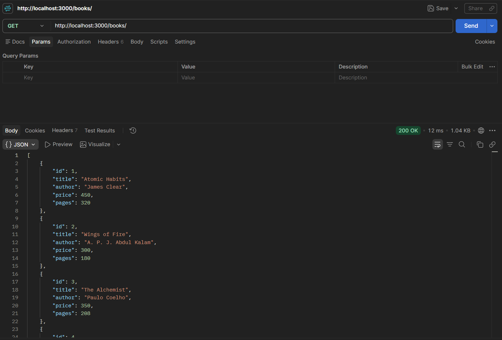
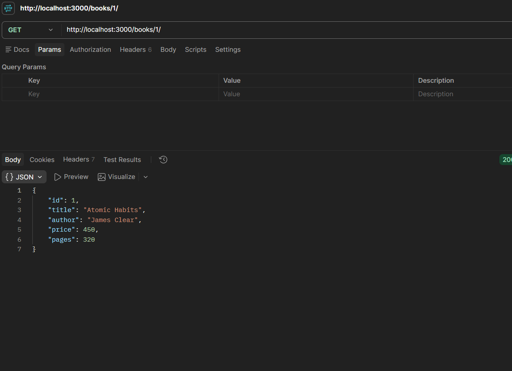
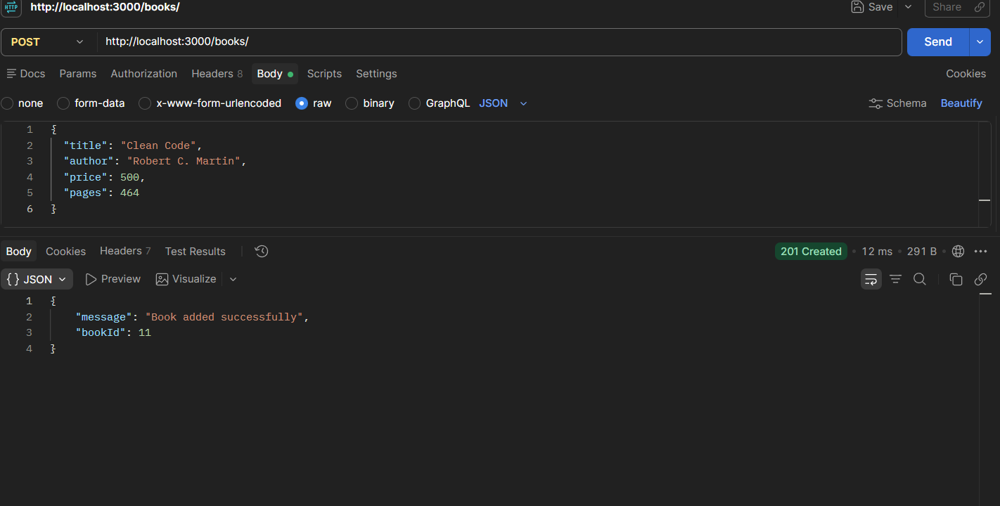
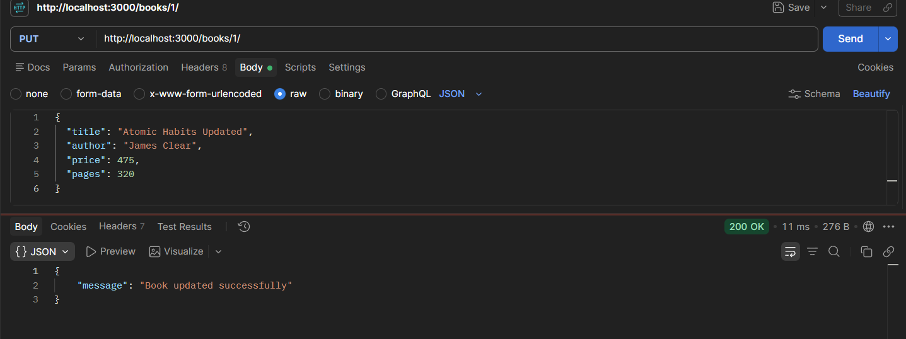
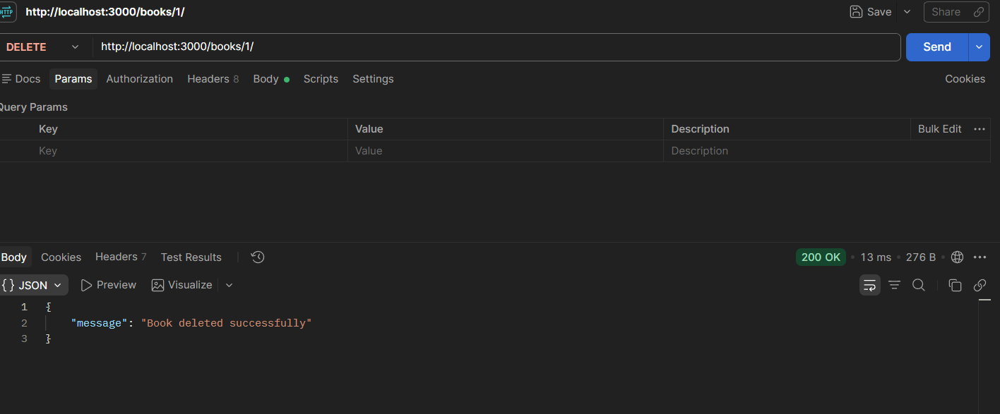

# Lab 2: SQLite Database and CRUD Routes

**Name:** Akku Lasya 
**Registration Number:** 252U1R9005 
**Section:** CSE-GAI-2A

## Overview
An Express.js API connected to a SQLite database for
creating, reading, updating, and deleting book records.

## Live Link
Not deployed yet.

## How to Run

1. Install Node.js.
2. Clone the repository.
3. Open the lab-02 folder.
4. Install dependencies:

   npm install

5. Start the development server:

   npm run dev

The server runs at http://localhost:3000.

## Endpoints

| Method | Path | Description |
|---|---|---|
| GET | /books/ | Retrieve all books |
| GET | /books/:bookId/ | Retrieve one book |
| POST | /books/ | Add a book |
| PUT | /books/:bookId/ | Update a book |
| DELETE | /books/:bookId/ | Delete a book |

## Screenshots

### 1. Get All Books

### 2. Get a Single Book

### 3. Add a Book

### 4. Update a Book

### 5. Delete a Book

## Problems Faced and Solutions

Document the errors you encountered and how you resolved them.
